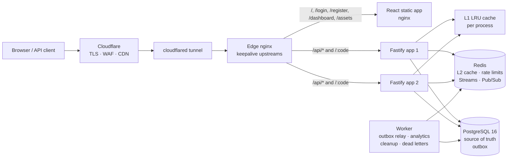

# Shortly — Scalable URL Redirection Platform

[](https://nodejs.org/)
[](https://fastify.dev/)
[](https://www.postgresql.org/)
[](https://redis.io/)
[](https://www.docker.com/)
[](https://www.cloudflare.com/)

A production-grade URL shortener built for read-heavy redirect traffic. Links are minted transactionally in PostgreSQL, served from a two-level cache (in-process LRU + Redis), and measured by asynchronous workers reading Redis Streams. The stack runs on a single small VM behind Cloudflare and scales horizontally inside Docker Compose. Accounts are optional: anyone can shorten a link from the landing page, and signing in with Google, GitHub, or email/password keeps a personal history with per-link expiry and ownership.

## Architecture



Request paths:

- **Redirect** `GET /:code` → L1 → Redis L2 → PostgreSQL behind a circuit breaker. Negative (404) and disabled (410) results are cached too.
- **Create** `POST /api/shorten` → PostgreSQL transaction (row + outbox event) → cache warm/invalidate via Redis Pub/Sub.
- **Analytics** redirects only append to an in-memory buffer; a batched pipeline writes to Redis Streams, and the worker aggregates clicks with SQL. Redirect latency never waits on analytics.
- **Accounts** Google/GitHub OAuth or email/password create a hashed password, an opaque cookie session, and email verification/reset tokens. Links created while signed in carry `urls.user_id`; listing and mutation are scoped to that owner.
- **Management** list, retarget, expiry, disable, and stats require a signed-in session scoped to the owner. The admin API key remains an operator-level scope for global views.

## Stack

| Layer | Choice | Why |
| --- | --- | --- |
| Edge | Cloudflare + cloudflared, nginx | TLS/WAF/CDN without exposing the VM; nginx does keepalive upstreams and internal routing |
| API | Node.js 24, Fastify 5 | Low overhead, schema validation, structured logs, mature Postgres/Redis clients |
| Cache | In-process LRU + Redis 7 | Sub-millisecond hot hits, shared L2, negative caching, TTL jitter, single-flight |
| Storage | PostgreSQL 16 | Transactional creation, outbox, advisory-locked migrations |
| Async | Redis Streams consumer group | At-least-once analytics and lifecycle events without a broker to operate |
| Frontend | React 18 + Vite 6, hand-written CSS | Landing page, link dashboard, QR codes, charts, no UI framework payload |
| Observability | Prometheus metrics, pino JSON logs, request IDs | Scrape `/metrics` with a token; trace every response via `X-Request-Id` |

## Features

- Base62 short codes with optional custom aliases (3–32 URL-safe characters, reserved words blocked).
- Optional accounts: Google and GitHub OAuth, email/password registration, email verification, and single-use password reset.
- Opaque cookie sessions (SHA-256-hashed server-side, HttpOnly, SameSite=Lax, Secure in production) with scrypt password hashing.
- Per-user link history; owners can retarget, change or clear expiry, disable, and view analytics for their own links only. Anonymous links stay unowned.
- Dashboard, link details modal, and account settings for signed-in users; authenticated routes redirect to sign-in.
- Link expiration with background cleanup, and explicit disabled (410) semantics.
- Public link creation with rate limiting; owner-scoped management plus an operator API key with constant-time comparison.
- Two-level caching with negative/410 caching, TTL jitter, request coalescing, and Pub/Sub invalidation across API instances.
- Circuit breaker plus explicit `503` + `Retry-After` when PostgreSQL is unavailable.
- Click analytics: daily series, device, referrer, and top links, aggregated by batch workers.
- Transactional outbox and dead-letter stream for lifecycle events; idempotent, batched handlers.
- Versioned SQL migrations guarded by an advisory lock.
- Health probes (`/health/live`, `/health/ready`), Prometheus metrics, structured logs with redaction.
- Landing page with a public shorten box, QR download, deep-linkable link details, and a responsive account dashboard.
- Docker Compose with two API replicas, a worker, static frontend, edge nginx, and an optional Cloudflare Tunnel profile.

## Accounts and authentication

The landing page stays public: anyone can shorten a URL without an account and the result stays unowned. Creating an account adds a history and per-link controls.

- **Password accounts.** Emails are normalized, passwords are hashed with scrypt, and login always performs a hash comparison (including a dummy hash for unknown emails) to avoid timing leaks.
- **OAuth.** Google and GitHub use the authorization-code flow with server-side token exchange. A short-lived HMAC-signed cookie binds the callback to the browser, and the provider must mark the email verified before an identity is created or linked.
- **Sessions.** A 32-byte opaque token is set in an HttpOnly, SameSite=Lax cookie (`Secure` in production). PostgreSQL stores only its SHA-256 hash, so logout, password reset, and the hourly cleanup worker can revoke sessions immediately.
- **Email verification and reset.** Tokens are random, hashed at rest, single-use, and expire after 60 minutes (verification) or 30 minutes (reset). Password reset revokes every existing session. Production needs SMTP, configured in `.env`.
- **Authorization.** Session requests are scoped to `urls.user_id`; another user receives `404` for reads and writes, not `403`, so link existence is not disclosed. The admin API key remains a global operator scope.
- **No account enumeration.** Registration reports conflicts, login returns a generic error, and password reset always answers `202` with identical copy.

Local development also exposes a one-click dev sign-in when `AUTH_DEV_LOGIN=true`. The flag is rejected at boot when `NODE_ENV=production`.

## Quick start (Docker)

Requirements: Docker Engine/Desktop with Compose v2.

```bash
cp .env.production.example .env
```

Set at least these values in `.env`:

```ini
BASE_URL=https://links.example.com
APP_URL=https://links.example.com
ADMIN_API_KEY=<openssl rand -hex 32>
SESSION_SECRET=<openssl rand -hex 32>
PGPASSWORD=<openssl rand -hex 24>
REDIS_PASSWORD=<openssl rand -hex 24>
METRICS_TOKEN=<openssl rand -hex 16>
```

Optionally add OAuth client IDs/secrets and SMTP settings. Without OAuth credentials the provider buttons are hidden; without SMTP, verification and reset emails are only logged in development. A production deployment should configure SMTP so accounts stay recoverable. See [`.env.production.example`](.env.production.example).

Then:

```bash
./scripts/deploy.sh            # validates compose, builds, waits for readiness, runs smoke tests
# or
docker compose up -d --build
```

The edge listens on `127.0.0.1:8080` by default (`EDGE_PORT`). For a public hostname, use the Cloudflare Tunnel profile:

```bash
# In Cloudflare Zero Trust: create a tunnel, public hostname -> http://nginx:80
echo 'TUNNEL_TOKEN=...' >> .env
docker compose --profile tunnel up -d
```

Without a tunnel, put your own TLS terminator (Caddy, host nginx, or Cloudflare proxied origin) in front of `127.0.0.1:8080`.

Local URLs:

- Landing page: `http://localhost:8080`
- Sign in / create account: `http://localhost:8080/login`, `/register`
- Account dashboard: `http://localhost:8080/dashboard`
- Health: `http://localhost:8080/health`

## Local development

Requirements: Node.js 24, PostgreSQL 16, Redis 7.

```bash
# Backend
cd backend
cp ../.env.example .env        # localhost Postgres/Redis, dev session secret, dev login enabled
npm install
npm run migrate
npm run dev                    # API on :3000

# Worker (second terminal)
npm run worker

# Frontend (third terminal)
cd ../frontend
npm install
npm run dev                    # Vite on :5173; proxies /api and /health to :3000
```

The development admin key is `dev-admin-key`; production refuses that value at boot. With `AUTH_DEV_LOGIN=true` (development only) the sign-in page offers a one-click dev account. Emails are printed to the API logs when `SMTP_HOST` is empty; configure SMTP to send real verification and reset messages. To use OAuth locally, register `${OAUTH_CALLBACK_BASE}/api/auth/oauth/google/callback` and `/api/auth/oauth/github/callback` (default `http://localhost:3000`) and set the client credentials. Development sign-in is rejected when `NODE_ENV=production`.

## API

| Method | Path | Auth | Purpose |
| --- | --- | --- | --- |
| `POST` | `/api/shorten` | Public (rate limited) | Create a link: `{ url, customAlias?, expiresAt? }`; owned when a session cookie is present |
| `GET` | `/:code` | Public | `302` redirect, `404` unknown, `410` disabled/expired, `429` rate limited |
| `GET` | `/api/auth/providers` | Public | Enabled OAuth providers and dev-login availability |
| `POST` | `/api/auth/register` | Public (rate limited) | Create an email/password account and session |
| `POST` | `/api/auth/login` | Public (rate limited) | Sign in with email/password |
| `POST` | `/api/auth/logout` | Public | Revoke the current session (`204`) |
| `GET` | `/api/auth/me` | Session | Current user profile |
| `POST` | `/api/auth/verify-email` | Public | Consume a verification token |
| `POST` | `/api/auth/resend-verification` | Session | Send a fresh verification email |
| `POST` | `/api/auth/forgot-password` | Public (rate limited) | Request a reset link (enumeration-safe, `202`) |
| `POST` | `/api/auth/reset-password` | Public (rate limited) | Consume a reset token and revoke all sessions |
| `GET` | `/api/auth/oauth/:provider` | Public | Start Google/GitHub OAuth (redirect) |
| `GET` | `/api/auth/oauth/:provider/callback` | Public | Finish OAuth and set the session cookie |
| `GET` | `/api/auth/dev-login` | Dev only | One-click local sign-in; disabled in production |
| `GET` | `/api/links` | Session or bearer key | Paginated history, owner-scoped for sessions (`page`, `limit`, `q`, `status`) |
| `GET` | `/api/links/:code` | Session or bearer key | Link details, click totals, daily series, breakdown |
| `PATCH` | `/api/links/:code` | Session or bearer key | Retarget `{ url }` or change/clear expiration |
| `DELETE` | `/api/links/:code` | Session or bearer key | Disable a link (served as `410` afterwards) |
| `GET` | `/api/stats` | Session or bearer key | Caller-scoped totals, click series, top links, cache stats |
| `GET` | `/api/public/stats` | Public | Landing-page totals |
| `GET` | `/health/live` | Public | Process liveness |
| `GET` | `/health/ready` | Public | Postgres/Redis readiness |
| `GET` | `/metrics` | `X-Metrics-Token` or bearer | Prometheus exposition (404 otherwise) |

Example:

```bash
# Create an account and keep the session cookie
curl -c cookies.txt -X POST https://links.example.com/api/auth/register \
  -H 'Content-Type: application/json' \
  -d '{"email":"you@example.com","password":"a-long-password","name":"You"}'

# Shorten while signed in; the link is saved to your history
curl -b cookies.txt -X POST https://links.example.com/api/shorten \
  -H 'Content-Type: application/json' \
  -d '{"url":"https://example.com/launch","customAlias":"launch"}'

# List and manage only your own links
curl -b cookies.txt 'https://links.example.com/api/links?limit=10'

# Operator scope (all links, platform stats)
curl https://links.example.com/api/links?limit=10 \
  -H "Authorization: Bearer $ADMIN_API_KEY"
```

## Verification

```bash
cd backend && npm test                    # 10 suites, 91 tests, coverage enabled
EDGE_URL=http://localhost:8080 ./scripts/smoke.sh
TARGET_URL=http://localhost:8080 CONCURRENCY=50 DURATION_SECONDS=10 node scripts/load-test.js
```

The smoke suite exercises the real edge path: landing page, probes, public creation, redirect, duplicate alias, unknown code, API-key enforcement, listing, stats, retarget, disable, 410, token-protected metrics, account registration/login/logout, owner-scoped history and mutation isolation, expiry changes, enumeration-safe password reset, and cross-origin write rejection.

### Measured performance

Environment: Windows 11 host, Docker Desktop 29.5.2 (WSL2), two Fastify containers behind nginx, PostgreSQL and Redis in the same Compose network, 50 concurrent workers, 10 seconds per scenario, client and server on the same machine.

| Scenario | Requests | Achieved RPS | p50 | p95 | p99 | Errors |
| --- | ---: | ---: | ---: | ---: | ---: | ---: |
| Warm cache (hot links) | 25,186 | 2,518 | 18.50 ms | 31.28 ms | 39.01 ms | 0 |
| Zipf-like (80/20 hot/tail) | 24,692 | 2,468 | 18.38 ms | 32.48 ms | 43.69 ms | 0 |
| Invalid codes (negative cache) | 23,944 | 2,393 | 18.84 ms | 34.60 ms | 50.06 ms | 0 |

All scenarios met the SLOs (`p95 < 50 ms`, `p99 < 100 ms`). These numbers include the loopback hop through Docker Desktop; a Linux VM exposes the same containers without the WSL network layer. Raw results are written to `validation/load-test-*.json` (git-ignored).

## Configuration

All settings are environment variables. The full list lives in [`.env.production.example`](.env.production.example) and [`.env.example`](.env.example); the ones that matter most:

| Variable | Default | Notes |
| --- | --- | --- |
| `BASE_URL` | required | Public origin used to build short URLs |
| `APP_URL` | required | Browser origin used for OAuth redirects and email links |
| `ADMIN_API_KEY` | required | 32+ random characters, compared in constant time |
| `SESSION_SECRET` | required in production | Signs OAuth state cookies; generate with `openssl rand -hex 32` |
| `PGPASSWORD`, `REDIS_PASSWORD` | required | Secrets are stripped from logs |
| `EDGE_PORT` | `8080` | Host loopback port for the edge |
| `SESSION_TTL_DAYS` | `30` | Lifetime of an opaque cookie session |
| `AUTH_DEV_LOGIN` | `false` | One-click dev sign-in; production refuses `true` |
| `AUTH_REQUIRE_EMAIL_VERIFICATION` | `false` | Enable only after SMTP works |
| `PASSWORD_MIN_LENGTH` | `10` | Minimum password length (max 200) |
| `OAUTH_CALLBACK_BASE` | `BASE_URL` | Origin registered in Google/GitHub OAuth apps |
| `GOOGLE_CLIENT_ID/SECRET` | empty | Google sign-in; blank hides the button |
| `GITHUB_CLIENT_ID/SECRET` | empty | GitHub sign-in; blank hides the button |
| `SMTP_HOST/PORT/SECURE/USER/PASS` | empty | Transactional email; required for verification/reset in production |
| `MAIL_FROM` | `Shortly <no-reply@…>` | Envelope sender for auth email |
| `L1_MAX_ENTRIES` | `20000` | Per-process LRU size |
| `L2_DEFAULT_TTL_SECONDS` | `3600` | Redis TTL, jittered per key |
| `RATE_LIMIT_REDIRECT_MAX` | `1200` | Redirects per IP per minute |
| `RATE_LIMIT_SHORTEN_MAX` | `20` | Creations per IP per minute |
| `RATE_LIMIT_AUTH_MAX` | `20` | Auth requests per IP per 5-minute window |
| `METRICS_PUBLIC` | `false` | Keep metrics private and scrape with `METRICS_TOKEN` |
| `TUNNEL_TOKEN` | empty | Enables the optional `tunnel` profile |

## Operations

```bash
docker compose ps                        # service health
docker compose logs -f worker            # analytics/outbox logs
docker compose up -d --build             # rolling apply of code changes
./scripts/backup-db.sh                   # pg_dump into backups/ with retention
./scripts/smoke.sh                       # post-deploy checks
```

Migrations run once per deploy via the `migrate` service, which uses a Postgres advisory lock so replicas cannot race.

Notes on scaling: nginx currently names `app1` and `app2` explicitly. To run more than two API replicas, add matching `server` entries to the `api_upstream` block in `nginx/nginx.conf`. Redis L2 and PostgreSQL are shared, so API replicas stay stateless; L1 caches are invalidated across instances through Redis Pub/Sub.

### Backups and retention

`pg_dump` runs against the Compose network from the host, so no extra container is needed. Schedule it with cron and copy `backups/` off the VM. Test restores periodically with `psql -f`.

### Troubleshooting

- **Docker Desktop engine crash during build** (panic/SIGSEGV in BuildKit): a known Docker Desktop/WSL issue, not an application error. Build with the legacy builder: `DOCKER_BUILDKIT=0 COMPOSE_BAKE=false docker compose build`, then `docker compose up -d`.
- **Tunnel shows 502**: `cloudflared` must reach `http://nginx:80`; check the tunnel's public hostname and that nginx reports healthy.
- **Readiness fails**: `docker compose logs postgres redis app1`; migrations may have failed on first boot.

## Project structure

```
backend/
  src/
    routes/       shorten, redirect, links, auth, health
    services/     url, cache, queue, code generation, auth, oauth, mailer
    cache/        LRU, invalidation (Pub/Sub)
    workers/      worker entry, analytics, lifecycle, cleanup
    db/           pool, queries, versioned migrations
    plugins/      redis, postgres, auth, metrics, rate limiting
  tests/          unit + integration (Jest, mock DB)
frontend/
  src/
    pages/        landing, auth (login/register/reset), dashboard, 404
    hooks/        session context + debounce
    components/   shorten form, link table, details modal, charts, UI kit
    api/          cookie-based client with session events
nginx/            edge reverse proxy, SPA routes, short-code catch-all
scripts/          deploy, smoke, load test, database backup
legacy/           previous FastAPI implementation kept for reference
docker-compose.yml
```

## Design notes

- **Public creation, owner-scoped management.** Anyone can shorten; signing in attaches the link to an account. Sessions list and mutate only their own rows, while the admin API key keeps an operator-wide scope.
- **Sessions are opaque and server-revocable.** Only a SHA-256 hash of the 32-byte cookie lives in PostgreSQL; logout, password reset, and the hourly worker can terminate sessions immediately.
- **OAuth state is signed and single-use.** A short-lived HMAC cookie binds the callback to the browser that started the flow, so a stolen code cannot be replayed elsewhere.
- **Analytics never blocks redirects.** Under extreme overload the bounded buffer drops events rather than adding latency; the tradeoff is deliberate.
- **Fail-open caches, fail-fast database.** Redis outages degrade throughput but not correctness; database outages return an explicit 503 instead of hanging.
- **Aliases and codes share one namespace.** Reserved words (`api`, `dashboard`, `login`, `register`, `health`, `metrics`, `assets`, and similar) are rejected at creation time.
- **The outbox is the consistency boundary.** Link writes and their events commit together; the worker retries with a dead-letter stream for poison messages.

## License

Built by [Kunal Bavdhane](https://github.com/kunalbavdhane9922) as part of distributed backend systems engineering coursework.
